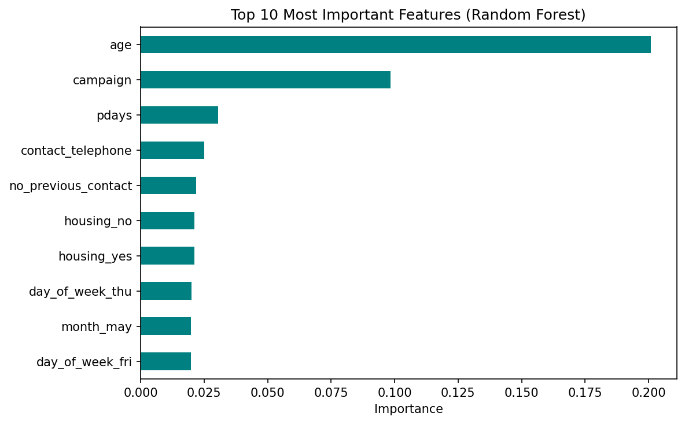

# Bank Customer Response Prediction

A machine learning project that predicts whether a bank customer will subscribe to a term deposit after a marketing call, using customer details and past contact history.

## Dataset
- Bank Marketing dataset (UCI Machine Learning Repository), preprocessed
- 41,188 records and 59 features (age, job, marital status, education, contact history and more)
- Target: whether the customer subscribed to a term deposit (1 = yes, 0 = no)
- Imbalanced: only about 11% of customers are labelled 1
- Original data by Moro, Cortez and Rita (2014)

## Approach
1. Explored the data and visualised the target and key features
2. Split into 80% training and 20% testing data
3. Trained Logistic Regression, Random Forest, Decision Tree and XGBoost
4. Handled class imbalance using class weights
5. Evaluated with recall, precision and F1-score, not only accuracy

## Why Not Just Accuracy?
About 89% of customers are labelled 0, so a model that always predicts 0 would already score about 89% accuracy. Recall and F1 show how well the model finds the customers who actually matter.

## Results
| Model | Accuracy | Recall | F1 |
|---|---|---|---|
| Logistic Regression (default) | 89.6% | 19% | 0.29 |
| Random Forest (default) | 88.7% | 25% | 0.34 |
| XGBoost (balanced) | 81.8% | 52% | 0.39 |

XGBoost with class balancing found the most positive cases, with recall improving from 19% to 52% compared with default Logistic Regression.

## Feature Importance

The Random Forest relied most on age, the number of contacts in the campaign, and the days since the last contact.

## Tools and Libraries
Python, Pandas, NumPy, Matplotlib, Seaborn, Scikit-learn, XGBoost, Jupyter Notebook

## How to Run
1. Download or clone this repository
2. Install the libraries: `pip install pandas numpy matplotlib seaborn scikit-learn xgboost`
3. Open `bank_customer_response_prediction.ipynb` and run all cells from top to bottom

## Author
Dhyani Bhavsar
